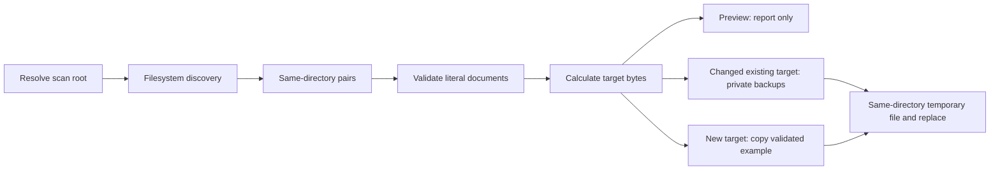

# Architecture

[English](overview.md) | [Português brasileiro](../../pt-BR/architecture/overview.md)

The [README](../../../README.md) owns the CLI contract and complete exclusions. The implementation is one [standard-library script](../../../scripts/audit-envs.py), organized around discovery, literal parsing, planning and per-target persistence.

## Responsibilities and flow

`main` parses mutually exclusive preview flags and resolves the root. `resolve_root` uses the resolved script's `parents[2]`, so the default follows the current portfolio layout rather than the caller's working directory; explicit relative roots use the caller. `discover` recursively groups eligible files by directory using `os.scandir`, ignoring Git tracking and skipping child symlinks. It returns discovered groups, errors and links separately, allowing accessible pairs to proceed after discovery errors.

`read_document` checks regular-file status and `parse` creates ordered literal blocks. `plan` compares the target's key membership with a validated example: retain allowed blocks, remove absent keys, append missing example blocks. `run` chooses specific examples before the base fallback, reports the plan, and either previews or persists it. No application source analysis or value evaluation is involved.

## Decisions and trade-offs

Filesystem discovery includes ignored runtime files and nested projects without Git tooling. Exact exclusions bound traversal, but unlisted hidden storage/cache names are still scanned. Script-relative scope is stable across invocation directories but coupled to installation layout. There is no repository-marker search or ancestor scanning algorithm.

Authoritative examples make synchronization deterministic. Specific examples allow variant contracts; fallback examples reduce duplication. The guarantee is key membership, not runtime necessity or semantic validity. A required key omitted from the reference is removed even if code consumes it. An empty reference removes every active target assignment. Existing duplicates can survive; duplicate reference keys fail validation.

Literal blocks preserve retained values and multiline structure without sourcing input. This costs a limited parser rather than complete shell/dotenv support. New targets copy reference comments; existing targets do not import every reference comment. Reference values are trusted data, with no secret detection.

Planning is shared by writes and both preview aliases. Preview proves parsing/planning only, not future write permission or backup success. Errors are handled per pair; there is no all-workspace transaction.

## Persistence and failure boundaries

Changed existing targets are backed up before writing. Backups contain plaintext originals and removed blocks with restricted POSIX permissions. The temporary target stream is flushed and fsynced, then replaced with `os.replace`. Existing permission bits survive; ownership, ACLs, extended attributes and timestamps do not.

Atomicity applies to replacement of one file, not rollback of a group or durable directory metadata after power loss. There is no parent-directory fsync, concurrency lock or target-content recheck. Symlink checks prevent ordinary static traversal through links but do not eliminate time-of-check/time-of-use races. Cleanup is attempted in `finally`; a cleanup failure can leave a temporary file. Deep recursive traversal and output failures can raise exceptions outside the normal 0/1/2 exit contract.

A parser library, typed schema, explicit include-root policy, lock, retention policy or coordinated transaction could address stronger requirements. These are alternatives for study, not changes delivered in this review. See [test evidence and review limits](../testing/verification.md).

Presentation uses `comparison_rows` and `table`, separate from `plan`. Summary records retain the initial comparison and the outcome of each pair; project labels do not affect discovery or reference selection.
