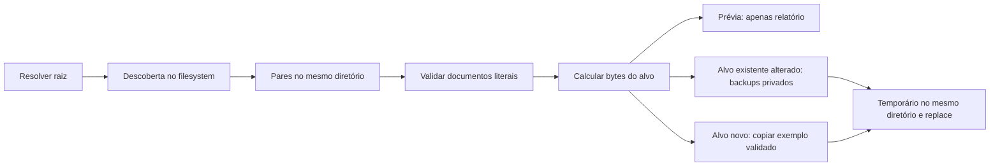

# Arquitetura

[English](../en/architecture.md) | [Português brasileiro](architecture.md)

O [README](../../README.pt-BR.md) mantém o contrato da CLI e todas as exclusões. A implementação é um [script da biblioteca padrão](../../scripts/audit-envs.py), organizado em descoberta, parsing literal, planejamento e persistência por alvo.

## Responsabilidades e fluxo

`main` interpreta flags de prévia mutuamente exclusivas e resolve a raiz. `resolve_root` usa `parents[2]` do script resolvido: o padrão segue o layout do portfólio, não o diretório do chamador; raízes relativas explícitas usam o chamador. `discover` agrupa arquivos elegíveis por diretório via `os.scandir`, sem consultar Git e sem seguir links filhos. Grupos, erros e links são retornados separadamente; pares acessíveis podem continuar após erros de descoberta.

`read_document` verifica arquivo regular; `parse` cria blocos literais ordenados. `plan` compara chaves do alvo com o exemplo validado: mantém blocos permitidos, remove chaves ausentes e acrescenta blocos ausentes da referência. `run` prioriza exemplos específicos, relata o plano e faz prévia ou persistência. Não há análise de código ou avaliação de valores.

## Decisões e trade-offs

Descoberta no filesystem inclui arquivos ignorados e projetos aninhados sem ferramentas Git. Exclusões exatas limitam a busca, mas storage/cache oculto não listado ainda é percorrido. Raiz pelo script estabiliza o escopo entre diretórios com acoplamento ao layout. Não há busca por marcadores de repositório ou algoritmo de varredura de ancestrais.

Exemplos autoritativos tornam o resultado determinístico. Referências específicas permitem contratos por variante; fallback reduz duplicação. A garantia é conjunto de chaves, não necessidade em runtime ou validade semântica. Chave necessária omitida é removida mesmo se consumida no código. Exemplo vazio remove todas as atribuições ativas. Duplicatas existentes podem permanecer; duplicatas na referência falham.

Blocos literais preservam valores/multilinha sem executar conteúdo, ao custo de parser limitado, sem gramática shell/dotenv completa. Alvos novos copiam comentários; existentes não importam todos os comentários da referência. Valores do exemplo são confiados, sem detecção de secrets.

O plano é compartilhado pela escrita e pelos dois aliases de prévia. Prévia prova parsing/planejamento, não permissões futuras ou sucesso de backup. Erros são tratados por par; não há transação de todo o workspace.

## Persistência e fronteiras de falha

Alvos existentes alterados recebem backup antes da escrita. São originais/blocos removidos em texto sensível com permissões POSIX restritas. O temporário recebe flush/fsync e é substituído por `os.replace`. Bits de permissão existentes permanecem; dono, ACLs, atributos estendidos e timestamps não.

Atomicidade é individual, sem rollback de grupo nem garantia de metadados de diretório após perda de energia. Não há fsync do diretório pai, lock ou rechecagem do conteúdo. Checagens de links evitam travessia estática, sem eliminar corridas entre checagem e uso. A limpeza é tentada em `finally`; sua falha pode deixar temporário. Recursão profunda e falhas de saída podem escapar ao contrato normal 0/1/2.

Biblioteca de parsing, schema tipado, raízes de inclusão explícitas, lock, retenção ou transação coordenada são alternativas para requisitos mais fortes, não alterações entregues aqui. Veja [evidências e limites](verification.md).
